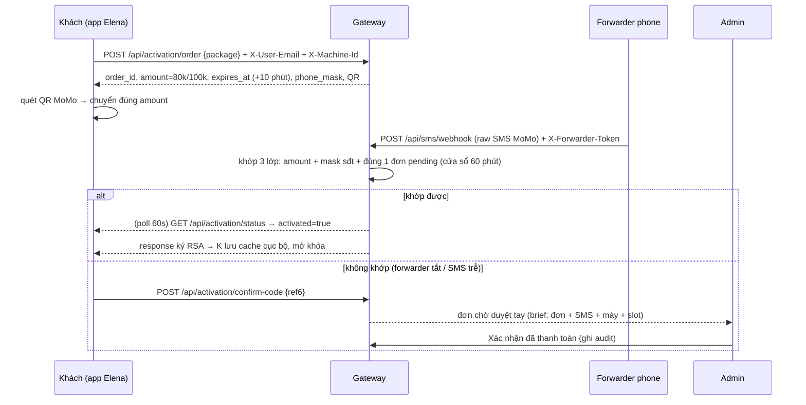
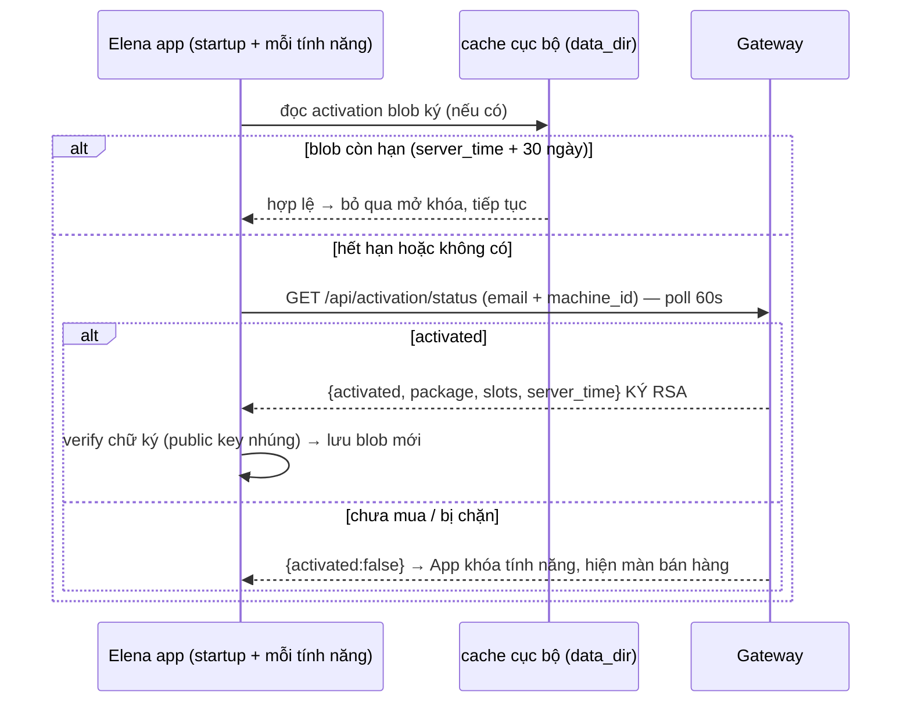

# Thiết kế: Server-side Entitlement cho Elena (bán & kích hoạt)

Phiên bản: 0.1 (draft từ phiên grilling 6/8/2026 — spec gốc: `workflows/sell-activate.md`)
Phạm vi: thiết kế kiến trúc — **không code trong tài liệu này**. Code theo sau ở giai đoạn triển khai.

## 1. Nguyên tắc (đã chốt với user)

1. **Không có license key cục bộ.** Quyền dùng Elena ("đã mua") là **entitlement trên server**, không phải file cài đặt.
2. **Server là nguồn sự thật duy nhất.** Client (app Elena) không bao giờ tự quyết "tôi đã mua". Client chỉ giữ:
   - session token đăng nhập (đã có, `/auth`),
   - **activation token ký RSA** do gateway cấp (mới) — bằng chứng "máy này đã mở khóa".
3. **Thanh toán = bằng chứng SMS MoMo** (webhook từ forwarder), không phải thẻ. Mô hình này giữ nguyên khi sau này chuyển sang Stripe/PayOS: chỉ thay "nguồn chứng minh đã trả tiền", entitlement vẫn do server cấp.
4. **Chống crack ≠ chống patch file.** Vì enforcement nằm ở server, attacker chỉ còn 4 vector: giả webhook thanh toán, giả/đánh cắp activation token, replay token cũ, share tài khoản vượt slot. Thiết kế này chống đúng 4 vector đó (bảng §7).

## 2. Kiến trúc tổng thể

```
┌─────────────────────┐   HTTPS + X-Activation-Token   ┌──────────────────────────────┐
│  ELENA APP          │ ──────────────────────────────► │  GATEWAY (activation API)   │
│  (D:\App\scan-de)   │                                 │  (D:\App\elena-gateway)     │
│                     │ ◄────────────────────────────── │                             │
│  engine/activation.py│  response KÝ RSA (token blob)  │  app/activation.py          │
│  cache cục bộ ký    │                                 │  khớp 3 lớp + khớp ngược    │
│  revalidate 30 ngày │                                 │  private key RSA            │
│  machine_id đa yếu tố│                                 └──────────────┬───────────────┘
└─────────────────────┘                                                │ psycopg (chỉ gateway)
                     SMS MoMo (forwarder phone)                        ▼
  ┌─────────────┐   POST /api/sms/webhook + X-Forwarder-Token  ┌──────────────────────┐
  │ FORWARDER   │ ────────────────────────────────────────────► │ PostgreSQL admin DB  │
  │ (đt cũ)     │                                               │ 6 bảng + audit       │
  └─────────────┘                                               └──────────────────────┘
```

- **Elena không bao giờ chạm DB admin** — chỉ gọi activation API qua HTTPS + cert pinning (tunnel Cloudflare).
- **Gateway là server duy nhất giữ private key RSA**; public key nhúng trong app → gateway giả / DNS redirect không thể ký được token hợp lệ.

## 3. Luồng MUA (đã spec — tóm tắt để đối chiếu code)



**Trạng thái code hiện tại (đã có ở gateway):** order (10 phút, cancel đơn cũ khi tạo mới), status (tự mở slot ≤5 khi máy mới đăng nhập), confirm-code, webhook SMS (khớp amount + đơn pending + cửa sổ 60 phút), block user, audit.

**Lỗ hổng/khoảng trống trong code hiện tại (sẽ vá ở giai đoạn triển khai):**
1. `qr` trả về `""` — chưa sinh QR thật (payload: `2|99|{forwarder_phone}|{amount}|" "|0|0|{nội dung}`).
2. `_sms_match` **không kiểm tra mask sđt** người nhận với forwarder phone đăng ký — mới chỉ khớp amount + đơn. Thêm điều kiện (b) của khớp 3 lớp.
3. Chưa có **khớp ngược**: SMS trong cửa sổ 60 phút mà không có đơn pending phải được giữ để khớp khi khách tạo đơn mới + bấm "Tôi đã chuyển".
4. `_machine_id` chỉ kiểm tra hình thức (hex ≥32) — chưa xác minh đó là **hash đa yếu tố** thật (chống clone). Việc này ở phía app (client) khi build `engine/activation.py`.

## 4. Luồng ENFORCEMENT runtime (mới — phần client)



### 4.1 Blob activation (cache cục bộ)

```
payload = {
  "user_id", "email", "machine_id",
  "package": "80k|100k", "slots": 1|5,
  "activated_at": <server time>, "issued_at": <server time>,
  "expires_at": issued_at + 30 ngày,
  "server_time": <server time khi ký>
}
blob = RSA-SHA256(ký payload) → lưu data_dir/activation.blob (đã DPAPI như google_links)
```

- **Chống sửa cache**: mọi lần đọc đều verify chữ ký — sửa 1 byte = vô hiệu, app coi như chưa mua.
- **Chống replay**: payload gắn `machine_id + user_id + server_time`; app bác token cũ/quá hạn và **bác đồng hồ tụt lùi** (nhớ server_time lần cuối; thời gian local nhỏ hơn → bắt revalidate).
- **Giới hạn ngoại tuyến**: hết 30 ngày mà không gọi được gateway → khóa khi đọc blob (không revalidate online liên tục).

### 4.2 Machine ID (client, `engine/activation.py`)

`machine_id = sha256(serial_ổ C: + volume_serial + MAC_primary + board_serial)` — Windows WMI/registry, stdlib/ctypes. Clone ổ → cùng ID → không nhân slot (chống #5).

### 4.3 Điểm chặn trong app

Dependency `require_entitlement` (giống `require_user` hiện tại), áp cho toàn bộ endpoint đã gate auth trừ `/health`, `/auth/*`:
`/jobs` (tạo scan), `/convert`, `/protect*`, `/library*` (kể cả download), `/settings`.
- Chưa có blob hợp lệ → 402 `{error: "Chưa kích hoạt — vào màn Mua"}`.
- Blob hết hạn → tự revalidate trước (1 lần) → vẫn lỗi mới chặn.
- Màn bán hàng UI: khi nhận 402 → hiện QR (từ `/activation/order`) + nút "Tôi đã chuyển" (kích poll ngay) + poll 60s.

## 5. Cổng thanh toán tương lai (Stripe/PayOS) — giữ nguyên kiến trúc

Chỉ thay "bằng chứng đã trả tiền": webhook Stripe (verify signature header `Stripe-Signature`, mã hóa HMAC-SHA256 payload) thay cho SMS forwarder. Phần còn lại (orders, entitlement, token ký, slot) không đổi. → Entitlement design này **không lệ thuộc cổng**.

## 6. Bảo mật webhook & API (đối chiếu với code hiện tại)

| Vector | Control | Hiện trạng |
|---|---|---|
| POST giả `{status:paid}` | Forwarder gửi qua `X-Forwarder-Token` (hmac.compare_digest) + khớp amount/mask/ref6 thật | ✅ có token; ⚠️ thiếu check mask sđt (§3.2) |
| Gọi thẳng activation API | `X-Activation-Token` bí mật dùng chung (đặt trong app) | ✅ có |
| Gateway giả / DNS redirect | HTTPS + cert pinning tunnel + **public key nhúng** xác minh chữ ký blob | ⚠️ chưa triển khai (giai đoạn client) |
| Share tài khoản >5 máy | slot đếm server-side (`machines` count) | ✅ có |
| Machine clone ổ | machine_id hash đa yếu tố | ⚠️ chưa (client) |

## 7. Đối chiếu 8 chống crack (spec sell-activate) → control trong thiết kế này

| # | Chống | Control |
|---|---|---|
| 1 | Giả gateway / DNS redirect | chữ ký RSA blob + public key nhúng + pinning |
| 2 | Replay | blob gắn machine_id+user_id+server_time; bác cũ/quá hạn |
| 3 | Sửa cache local | blob ký + DPAPI; verify mọi lần đọc |
| 4 | Giả SMS | X-Forwarder-Token + mask sđt + ref6 thật + khớp 3 lớp |
| 5 | Clone ổ | machine_id đa yếu tố (server chỉ nhận hash, không nhân slot) |
| 6 | Đồng hồ lùi né revalidate | nhớ server_time; tụt lùi → revalidate bắt buộc |
| 7 | Mổ xẻ PyInstaller | trần hợp lý — không chống tuyệt đối (đã chốt) |
| 8 | Share gói 100k | slot ≤5 đếm server-side |

## 8. Phân kỳ triển khai (đề xuất, chờ user duyệt)

- **P0 — Bảo mật thực thi (độc lập entitlement, đang làm)**: C1 SSRF hardening, C2 LO `--safe-mode`, C3 magic byte upload, C4 path traversal `mon/ten_de`.
- **P1 — Gateway hoàn thiện**: sinh QR thật, mask sđt trong khớp, khớp ngược 60 phút, sinh RSA keypair + ký response, `GET /activation/status` trả blob ký.
- **P2 — Client Elena**: `engine/activation.py` (machine_id đa yếu tố, RSA verify, blob cache + DPAPI, revalidate 30 ngày), `require_entitlement`, màn bán hàng + poll 60s (impeccable/design-taste).
- **P3 — Vận hành**: Cloudflare Tunnel, forwarder phone cũ, admin brief trên gateway (đã có khung).

## 9. Định nghĩa hoàn thành (cho P1+P2)

- Khách tạo đơn → QR thật quét chuyển đúng tiền → SMS forwarder → khớp 3 lớp (có mask) → máy mở khóa trong < 2 phút.
- Quét QR cũ sau khi đơn đóng → khớp ngược khi tạo đơn mới → không mất tiền.
- App khởi động không mạng → blob còn hạn vẫn dùng được; hết 30 ngày → khóa.
- Sửa 1 byte blob → app coi như chưa mua. Clone ổ → không nhân slot. Replay blob cũ → bị bác.
- Mọi endpoint thực thi đều qua `require_entitlement`; màn bán hàng hiển thị khi 402.
